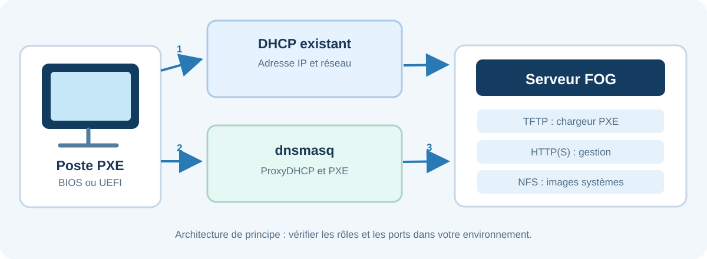
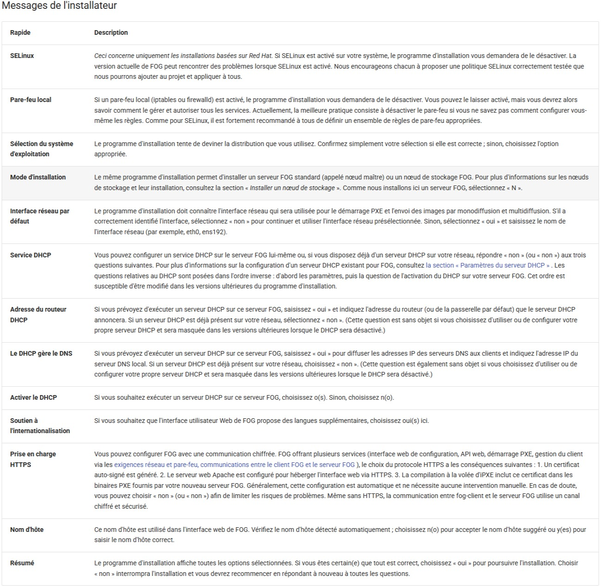
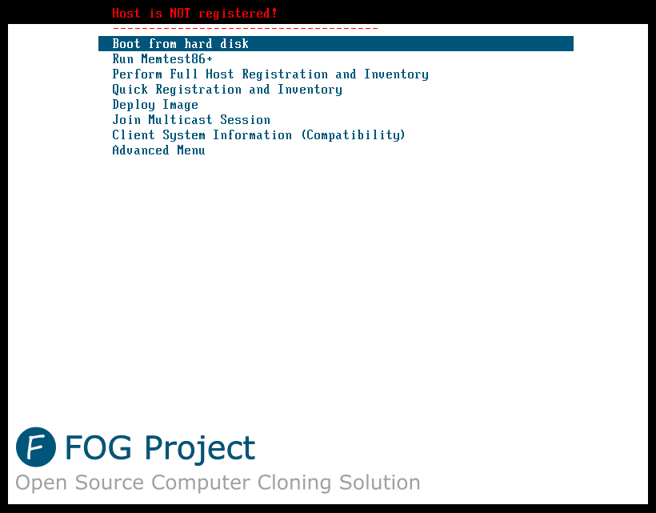
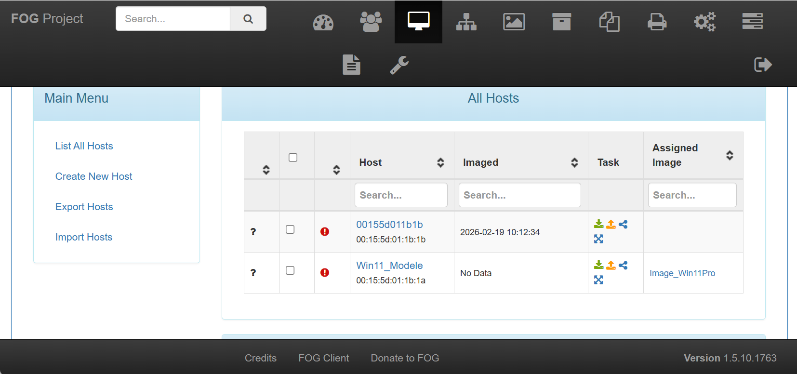
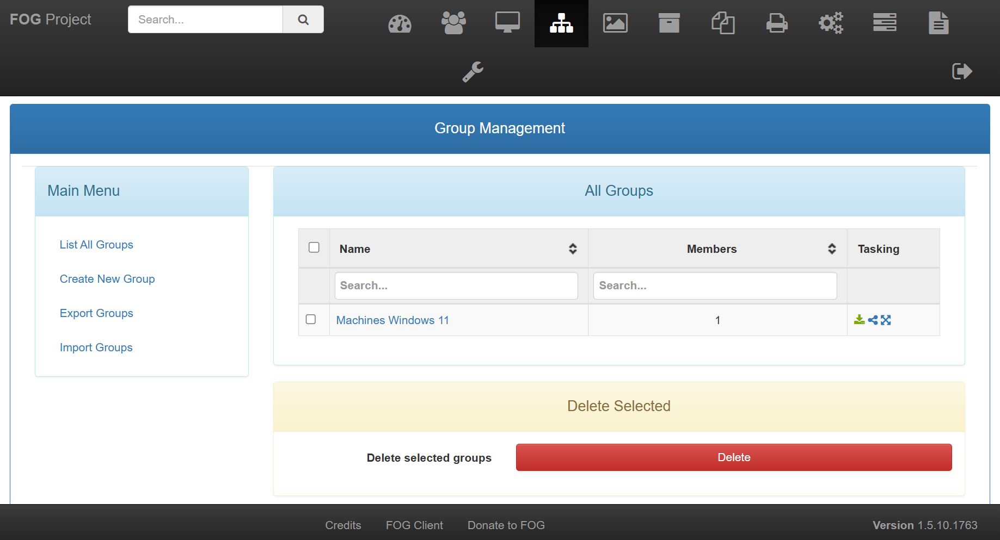
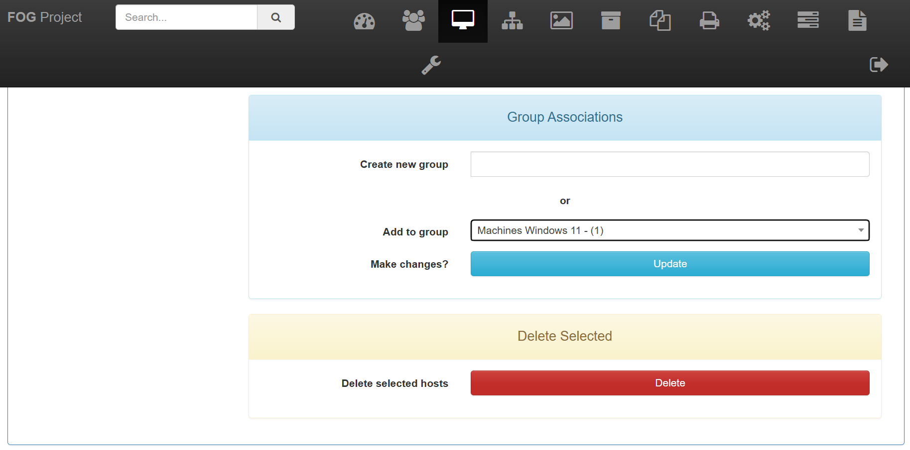
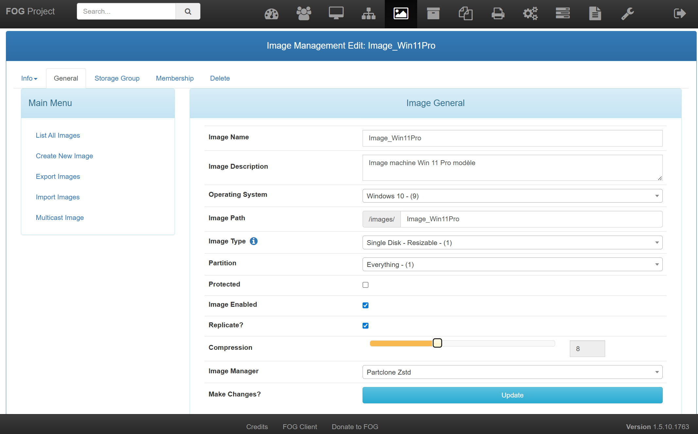
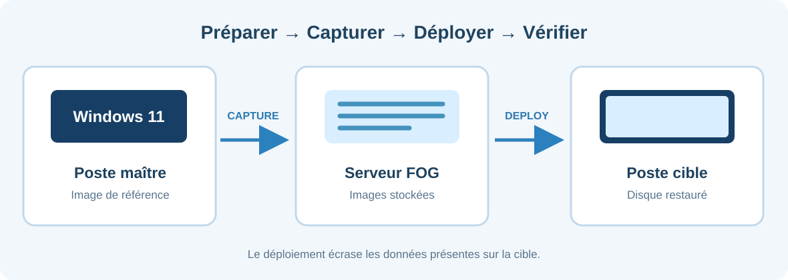
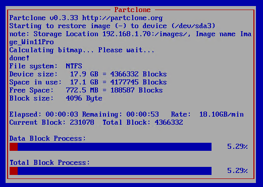

# Installation et exploitation de FOG Project

<div class="fog-hero"><div><span class="fog-eyebrow">GUIDE TECHNIQUE · DÉPLOIEMENT DE PARC</span><p class="fog-hero-title">Du serveur Linux à la restauration d'un poste par le réseau</p><p>Installation de FOG, configuration PXE, inventaire, capture Windows 11 et déploiement sur une machine virtuelle vierge.</p><div class="fog-badges"><span>Linux</span><span>PXE / iPXE</span><span>Windows 11</span><span>FOG 1.5 / 1.6 : vérifier la version</span></div></div><div class="fog-hero-monogram" aria-hidden="true">FOG<small>PROJECT</small></div></div>

<div class="fog-summary">
  <div><strong>Objectif</strong><span>Centraliser la capture et le déploiement des systèmes.</span></div>
  <div><strong>Niveau</strong><span>Intermédiaire, administration Linux et réseaux.</span></div>
  <div><strong>Contexte</strong><span>Serveur dédié, DHCP existant et machines de laboratoire.</span></div>
</div>

!!! danger "Sauvegarde et autorisation"
    Une tâche de déploiement remplace les données du disque cible. Vérifiez l'identité de la machine, l'image et le stockage avant toute opération. Utilisez exclusivement une infrastructure sur laquelle vous êtes autorisé à intervenir.

Ce dossier suit le scénario technique du [guide FOG de MilesChristi](https://mileschristi.github.io/runbook/installations/fog-installation/). Sa rédaction et ses schémas sont originaux. Les indications concernant les chargeurs PXE, les règles de pare-feu et le multicast ont été complétées à partir de la documentation officielle FOG consultée en octobre 2026. La procédure n'a pas été exécutée dans un laboratoire pour cette publication.

## 1. Architecture et principe {#architecture}

FOG Project est une solution libre de déploiement et de clonage. Une machine démarre par le réseau, reçoit un environnement d'exécution, puis copie son disque vers le serveur ou restaure une image déjà conservée.

Dans le scénario retenu, un serveur DHCP existe déjà. Il continue de fournir les adresses IP. **dnsmasq ne distribue aucun bail : il agit comme ProxyDHCP**, chargé d'indiquer au client PXE où trouver son chargeur de démarrage.



| Élément | Rôle |
| --- | --- |
| DHCP existant | Adresse IP, masque, passerelle et DNS |
| dnsmasq ProxyDHCP | Indication du serveur et du fichier d'amorçage |
| Service TFTP de FOG | Distribution du chargeur iPXE |
| Interface HTTP(S) | Administration, hôtes, images et tâches |
| Stockage NFS | Capture et restitution des partitions |

!!! warning "Éviter les conflits DHCP"
    Ne mettez pas en service un deuxième DHCP attribuant des adresses sur le même réseau sans configuration et validation explicites. Ce guide décrit FOG **sans DHCP intégré**, associé à dnsmasq en mode proxy.

## 2. Prérequis {#prerequis}

### Serveur Linux

Le guide source décrit un serveur Debian 12/13 ou Ubuntu Server 20.04, 22.04 ou 24.04. Cette liste correspond au contexte original et ne constitue pas une garantie de prise en charge actuelle. Choisissez une version de Linux compatible avec la version FOG visée et encore maintenue dans votre environnement.

| Ressource | Base du laboratoire |
| --- | --- |
| CPU | 2 cœurs |
| Mémoire vive | 4 Go, idéalement 8 Go |
| Stockage | Environ 100 Go pour commencer, selon les images |
| Réseau | Ethernet et adresse IP fixe |
| Administration | Console ou SSH, compte sudo |

Le stockage doit être dimensionné selon le nombre d'images, les partitions à capturer et la rétention souhaitée. Prévoyez aussi une sauvegarde du serveur et des images critiques.

Réunissez l'adresse IPv4 du serveur FOG, le masque, la passerelle, les VLAN concernés et les paramètres du DHCP existant. Dans ce tutoriel, **192.0.2.10** est une adresse fictive réservée aux exemples. Remplacez-la partout avant une utilisation réelle.

### Postes à déployer

Le démarrage PXE doit être activé. Relevez le mode BIOS ou UEFI de chaque équipement, contrôlez l'ordre de démarrage et vérifiez l'accès Ethernet. Pour Hyper-V, le réseau virtuel doit permettre les échanges avec le DHCP, dnsmasq et FOG.

Le traitement de **Secure Boot** dépend de la version FOG et des binaires sélectionnés. Ne le désactivez pas de manière systématique. Consultez la documentation de votre version avant de modifier les paramètres du firmware.

### Principaux flux réseau

Le pare-feu doit autoriser les services nécessaires entre les clients et le serveur, sans ouvrir les ports vers des réseaux non concernés.

| Ports | Protocole | Usage |
| --- | --- | --- |
| 69 | UDP | TFTP et amorçage initial |
| 4011 | UDP | Échanges PXE/ProxyDHCP selon le scénario |
| 80 et éventuellement 443 | TCP | Accès web et fichiers de démarrage |
| 111, 20048 | TCP/UDP | Services RPC/NFS |
| 2049 | TCP | Échanges NFS pour les images |
| 21 et plage FTP passive configurée | TCP | Stockage et réplication selon les fonctions |
| Ports du multicast, selon FOG | UDP | Distribution simultanée |

Les règles NFS, FTP et multicast constituent un complément à la liste réduite du tutoriel d'origine. Référence : [pare-feu d'un serveur FOG](https://docs.fogproject.org/en/latest/kb/how-tos/firewall/).

## 3. Installer FOG sur Linux {#installation}

### Mettre en place le système

!!! tip "Copier une commande"
    Chaque encadré de terminal comporte un bouton **Copier**, visible en haut à droite. Utilisez les commandes dans le terminal indiqué et adaptez les paramètres propres à votre serveur.

Sur une machine Linux dédiée, ouvrez une session disposant de sudo. Identifiez l'OS et l'adresse utilisée :

```bash title="Terminal Linux"
cat /etc/os-release
ip -br address
```

Actualisez la liste des paquets, puis installez Git et curl :

```bash title="Terminal Linux"
sudo apt update
sudo apt install -y git curl
```

Le tutoriel source inclut aussi une mise à niveau complète du système. Sur un serveur existant, cette opération nécessite une vérification d'impact et une fenêtre de maintenance.

### Télécharger le dépôt officiel

```bash title="Terminal Linux"
cd ~
git clone https://github.com/FOGProject/fogproject.git fogproject-stable
cd fogproject-stable
git branch --show-current
git rev-parse --short HEAD
```

Enregistrez la branche et le commit. Cela permettra de retrouver la version utilisée lors d'une maintenance ultérieure.

### Lancer l'installateur

```bash title="Terminal Linux"
cd bin
sudo ./installfog.sh
```

Vérifiez soigneusement les réponses : système, interface réseau, adresse du serveur et choix du service DHCP. Dans notre configuration, le DHCP existant reste le seul service chargé d'attribuer des adresses.

L'installateur peut demander d'initialiser ou de mettre à jour la base de données. Ouvrez alors l'interface dans un navigateur :

```text title="Adresse de l'interface FOG"
http://ADRESSE_DU_SERVEUR/fog/management
```

L'adresse peut utiliser HTTPS, selon votre installation. Finalisez l'opération dans la page web **avant de valider la fin dans le terminal**.

Après installation, connectez-vous avec les informations indiquées par votre propre programme d'installation. **Changez immédiatement les mots de passe initiaux.** Aucun identifiant par défaut ne doit rester exploitable.

{ .fog-screenshot loading=lazy }

*Capture 1. Étapes d'installation de FOG sur Linux.*

### Premier contrôle

Vérifiez la présence de l'interface FOG depuis un poste du réseau d'administration. Sur Linux :

```bash title="Terminal Linux"
sudo systemctl --failed
sudo ss -lntup
```

Relevez la version affichée dans **FOG Configuration → FOG Settings → General → FOG_VERSION**. La configuration des chargeurs dépend de ce paramètre.

Documentation officielle : [installation du serveur FOG](https://docs.fogproject.org/en/latest/installation/server/install-fog-server/).

## 4. Paramétrer dnsmasq ProxyDHCP {#dnsmasq}

### Installer et identifier les services

```bash title="Terminal Linux"
sudo apt update
sudo apt install -y dnsmasq
dnsmasq --version
```

Avant de choisir les fichiers de démarrage, regardez ce qui est réellement installé dans le répertoire TFTP :

```bash title="Terminal Linux"
ls -lah /tftpboot
find /tftpboot -maxdepth 3 -type f -name '*.efi'
```

Le guide source utilise notamment `undionly.kpxe` et `ipxe.efi`. Dans la documentation FOG publiée pour **1.6**, les exemples de fichiers sont différents, avec `undionly.kkpxe`, `snponly.efi` et une chaîne UEFI signée. **Il faut choisir les noms correspondant à la version effectivement installée.**

### Créer le fichier du ProxyDHCP

Ouvrez un fichier de configuration dédié :

```bash title="Terminal Linux"
sudo nano /etc/dnsmasq.d/fog-proxy.conf
```

L'exemple suivant illustre **FOG 1.6**, sur un réseau de laboratoire et avec les fichiers de démarrage indiqués. Il nécessite une adaptation complète avant exécution.

```ini title="Configuration dnsmasq"
# ProxyDHCP, sans serveur DNS ni DHCP d'adressage.
port=0
log-dhcp
dhcp-no-override

# Identification des types de client.
dhcp-vendorclass=BIOS,PXEClient:Arch:00000
dhcp-vendorclass=UEFI32,PXEClient:Arch:00006
dhcp-vendorclass=UEFI64A,PXEClient:Arch:00007
dhcp-vendorclass=UEFI64B,PXEClient:Arch:00009

# Fichiers du serveur FOG. IP fictive a remplacer.
dhcp-boot=net:BIOS,undionly.kkpxe,,192.0.2.10
dhcp-boot=net:UEFI32,i386-efi/snponly.efi,,192.0.2.10
dhcp-boot=net:UEFI64A,secureboot/snponly-shimx64.efi,,192.0.2.10
dhcp-boot=net:UEFI64B,secureboot/snponly-shimx64.efi,,192.0.2.10

pxe-prompt="Demarrage FOG",1
pxe-service=X86PC,"FOG BIOS",undionly.kkpxe,192.0.2.10
pxe-service=IA32_EFI,"FOG UEFI 32",i386-efi/snponly.efi,192.0.2.10
pxe-service=X86-64_EFI,"FOG UEFI 64",secureboot/snponly-shimx64.efi,192.0.2.10
pxe-service=BC_EFI,"FOG UEFI PXE BC",secureboot/snponly-shimx64.efi,192.0.2.10

dhcp-range=192.0.2.10,proxy
```

Cette configuration suppose que **le service TFTP est géré par FOG**, pas par dnsmasq. N'ajoutez pas `enable-tftp` sans raison : deux services à l'écoute du même port risquent d'entrer en conflit.

Les règles `pxe-service` peuvent être prioritaires sur `dhcp-boot` pour certains firmwares UEFI. Modifiez-les de manière cohérente. Le chargement d'un binaire signé ne suffit pas, à lui seul, à terminer la configuration Secure Boot.

Source technique complémentaire : [dnsmasq ProxyDHCP pour FOG 1.6](https://docs.fogproject.org/en/latest/1.6/installation/network-setup/proxy-dhcp/).

### Valider et redémarrer

Commencez par tester la syntaxe :

```bash title="Terminal Linux"
sudo dnsmasq --test
```

Si aucune erreur n'est signalée :

```bash title="Terminal Linux"
sudo systemctl restart dnsmasq
sudo systemctl enable dnsmasq
sudo systemctl status dnsmasq --no-pager
```

En cas d'échec, lisez les journaux :

```bash title="Terminal Linux"
sudo journalctl -u dnsmasq -n 80 --no-pager
```

### Vérifier le service TFTP

```bash title="Terminal Linux"
sudo ss -lunp | grep ':69'
ls /tftpboot
```

Le serveur FOG doit proposer les fichiers attendus. Si le port 69 n'écoute pas ou si les fichiers sont absents, le client ne pourra pas charger l'environnement PXE.

### Contrôler le pare-feu

N'activez pas un pare-feu sur un serveur accessible seulement par SSH sans conserver d'abord le port d'administration. Le filtrage doit rester limité aux flux réellement nécessaires.

```bash title="Terminal Linux"
sudo ufw status verbose
sudo ufw allow 69/udp
sudo ufw allow 4011/udp
sudo ufw allow 80/tcp
# Autoriser 443/tcp si le service HTTPS est utilise.
```

Pour capturer ou déployer, vérifiez aussi les flux NFS. Les fonctions de réplication et multicast nécessitent d'autres règles, détaillées dans la documentation officielle. Ces commandes ne remplacent pas un plan de filtrage adapté à votre sous-réseau.

## 5. Préparer la machine Windows maître {#windows}

Le tutoriel original utilise **Windows 11 dans une VM Hyper-V**. Ce poste servira de référence. Finalisez d'abord l'installation, les mises à jour, les logiciels communs et la configuration souhaitée.

### Désactiver l'hibernation

Une veille hybride peut compliquer la capture des volumes. Dans un terminal administrateur Windows :

```powershell title="PowerShell administrateur"
powercfg /h off
```

Effectuez ensuite un arrêt complet du poste.

!!! note "Préparation avancée"
    Avant un déploiement sur plusieurs machines, examinez aussi les exigences d'identité Windows et la généralisation du système, notamment Sysprep lorsque cela s'applique. Le tutoriel initial ne détaille pas ce sujet.

### Configurer l'amorçage Hyper-V

Dans les propriétés de la machine virtuelle, vérifiez l'adaptateur réseau et l'ordre de démarrage. Pour une VM de génération 2, le périphérique réseau doit pouvoir être sélectionné dans les options de firmware. Placez-le avant le disque pour le test PXE.

Contrôlez aussi le commutateur virtuel. La machine doit atteindre le serveur DHCP, le ProxyDHCP et le serveur FOG.

## 6. Enregistrer le poste dans l'inventaire {#inventaire}

### Démarrage et inscription

Démarrez le poste maître par le réseau. Après l'obtention de l'adresse IP et le chargement d'iPXE, le menu FOG apparaît.

Choisissez **Quick Registration and Inventory** si cette option est disponible. Le système relève l'identité réseau et les principales informations matérielles.

{ .fog-screenshot loading=lazy }

*Capture 2. Démarrage PXE et enregistrement rapide du poste.*

### Contrôler et renommer l'hôte

Dans l'interface web, ouvrez **Hosts → List All Hosts**. La machine enregistrée doit apparaître dans la liste. Ouvrez sa fiche et attribuez-lui un nom clair, par exemple `WIN11-MODELE`.

{ .fog-screenshot loading=lazy }

*Capture 3. Inventaire des machines reconnues par FOG.*

### Rattacher le poste à un groupe

Dans FOG, les groupes facilitent le ciblage des machines. Créez un groupe correspondant à votre laboratoire ou à votre parc, puis associez-y le poste maître.

Contrôlez son appartenance avant de planifier une tâche. Une bonne organisation évite de confondre machine de référence et poste de destination.

{ .fog-screenshot loading=lazy }

*Capture 4. Organisation des postes au moyen d'un groupe.*

{ .fog-screenshot loading=lazy }

*Capture 5. Rattachement de la machine Windows au groupe.*

## 7. Créer et capturer une image {#capture}

### Déclarer l'image système

Ouvrez **Images → Create New Image**. Indiquez un nom explicite et les paramètres correspondant au système installé et à la structure des partitions.

{ .fog-screenshot loading=lazy }

*Capture 6. Définition de l'image destinée à la capture.*

### Associer l'image à la machine

Depuis la fiche **Host**, sélectionnez l'image à capturer, puis sauvegardez la configuration. Cette association est explicitement recommandée dans la [procédure officielle de capture](https://docs.fogproject.org/en/latest/kb/how-tos/capture-an-image/).

### Planifier et lancer la capture

Dans les tâches de l'hôte, choisissez **Capture**. Confirmez la création de la tâche, puis vérifiez sa présence dans **Tasks**.

Redémarrez la machine maître sur le réseau. FOG charge son environnement temporaire et copie les partitions vers le stockage du serveur. La durée dépend du volume de données, du réseau et des disques.

Au terme de l'opération, ouvrez **Images → List All Images**. Contrôlez que l'image est visible et disponible pour un déploiement. Le guide d'origine mentionne un exemple d'environ 10,5 Go après compression : ce résultat varie selon la machine.



## 8. Déployer sur une nouvelle machine {#deploiement}

### Préparer la cible

Le test décrit dans le tutoriel source utilise **Proxmox**. Créez une machine virtuelle vide et configurez les ressources nécessaires. À titre d'exemple, la source retient 8 Go de mémoire et un disque de 50 Go.

N'attachez pas d'ISO pour ce test de démarrage PXE. Connectez la VM au réseau autorisé et sélectionnez l'amorçage réseau.

### Choisir la tâche

Au menu FOG, choisissez **Deploy Image** ou planifiez un déploiement depuis l'interface web selon la version et la politique d'accès. Utilisez uniquement un compte FOG autorisé, avec un mot de passe sécurisé. Ne réutilisez pas les identifiants par défaut diffusés dans certains anciens tutoriels.

{ .fog-screenshot loading=lazy }

*Capture 7. Sélection de l'image lors d'un démarrage PXE.*

### Valider la restauration

Après une dernière vérification du poste et de l'image, lancez la tâche. Le contenu des partitions est réécrit sur le disque cible.

Laissez la procédure se terminer. Au redémarrage, contrôlez l'ouverture de Windows, les pilotes, la connectivité et les logiciels. La réussite ne se limite pas à la fin du transfert.

!!! danger "Effacement du disque cible"
    La restauration remplace les données présentes. Un ciblage incorrect peut entraîner une perte définitive des fichiers qui n'ont pas été sauvegardés.

## 9. Diagnostic et vérifications {#diagnostic}

| Symptôme | Cause à examiner | Contrôle |
| --- | --- | --- |
| Le poste n'obtient pas d'IP | DHCP ou liaison | VLAN, bail, carte Ethernet |
| Aucun menu PXE | ProxyDHCP ou chargeur incorrect | Journaux dnsmasq, type de firmware |
| Échec du téléchargement | TFTP ou pare-feu | Port UDP 69, fichiers `/tftpboot` |
| iPXE démarre, puis s'arrête | HTTP(S) ou chaîne d'amorçage | Services web et URL FOG |
| Le poste reste inconnu | Inventaire non exécuté | **Hosts → List All Hosts** |
| La capture échoue | Image, NFS ou stockage | Association de l'image, espace et NFS |
| Le déploiement échoue | Tâche ou disque cible | Configuration du poste et journaux |
| Multicast bloqué | Service, ports ou réseau | Session, nœud, flux UDP |

Commandes utiles sur Linux :

```bash title="Terminal Linux"
sudo systemctl --failed
sudo systemctl status dnsmasq --no-pager
sudo journalctl -u dnsmasq -n 100 --no-pager
sudo ss -lntup
sudo ss -lunp
df -h
```

Suivez l'ordre du démarrage : **DHCP → ProxyDHCP → TFTP → HTTP(S) → stockage**. Chercher une erreur NFS alors que la machine n'a pas encore reçu son chargeur PXE ne permet pas d'avancer efficacement.

### Contrôle final

- [ ] L'interface FOG est accessible depuis le réseau autorisé.
- [ ] Le DHCP et le ProxyDHCP remplissent des rôles distincts.
- [ ] Le chargement PXE fonctionne dans le mode firmware choisi.
- [ ] La machine maître est visible dans la liste des hôtes.
- [ ] L'image est créée et associée au bon poste.
- [ ] La capture s'est terminée sans erreur.
- [ ] Une cible de laboratoire a été restaurée avec succès.
- [ ] Windows démarre et les applications fonctionnent.
- [ ] Les identifiants initiaux ont été changés.

## 10. Références et captures {#references}

**Scénario de départ**

- [Tutoriel FOG Project de MilesChristi](https://mileschristi.github.io/runbook/installations/fog-installation/).
- [Dépôt GitHub de l'auteur et de ses captures](https://github.com/MilesChristi/runbook).

**Compléments vérifiés dans la documentation officielle**

- [Installer le serveur FOG](https://docs.fogproject.org/en/latest/installation/server/install-fog-server/).
- [ProxyDHCP et dnsmasq, FOG 1.6](https://docs.fogproject.org/en/latest/1.6/installation/network-setup/proxy-dhcp/).
- [Capturer une image](https://docs.fogproject.org/en/latest/kb/how-tos/capture-an-image/).
- [Déployer une image](https://docs.fogproject.org/en/latest/kb/how-tos/deploy-an-image/).
- [Pare-feu et ports FOG](https://docs.fogproject.org/en/latest/kb/how-tos/firewall/).
- [Sessions multicast, FOG 1.6](https://docs.fogproject.org/en/latest/1.6/management/web/multicast/).

**Illustrations.** Les sept captures d'écran proviennent du tutoriel d'origine et sont reproduites dans cette page avec l'autorisation déclarée par leur titulaire. Les deux schémas d'architecture et de cycle d'imagerie ont été réalisés spécialement pour cette documentation. Le texte conserve une rédaction originale.

*Rédaction : octobre 2026. Procédure à tester sur les versions et matériels réellement utilisés.*
