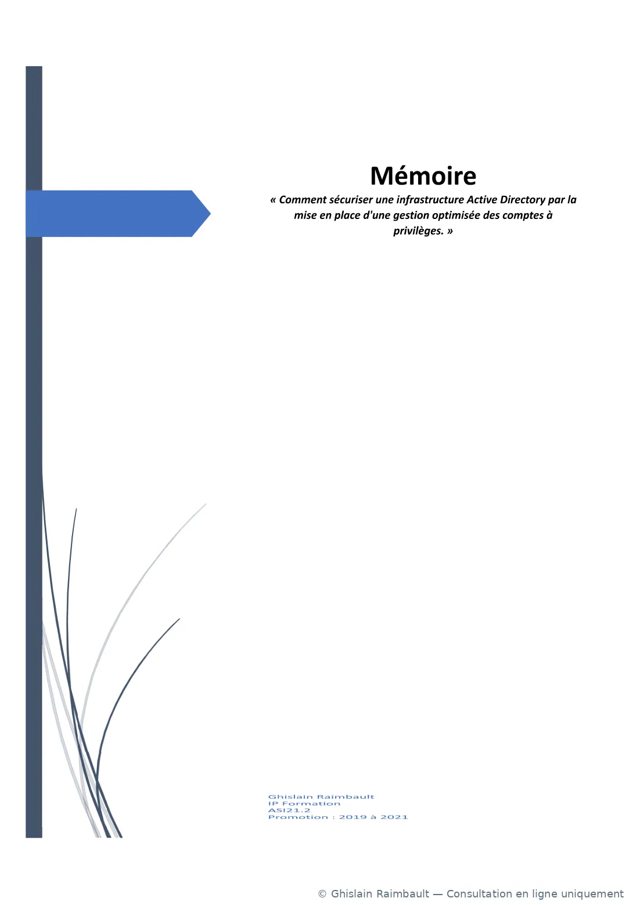

# Mémoire de fin d'études

  

    TRAVAIL DE RECHERCHE · ADMINISTRATION SYSTÈMES ET RÉSEAUX
    <h2>Comment sécuriser une infrastructure Active Directory par la mise en place d'une gestion optimisée des comptes à privilèges ?</h2>
    
Étude du risque lié aux comptes privilégiés, des approches de gestion des accès à privilèges (PAM) et du modèle de séparation des niveaux d'administration Microsoft. Le mémoire comporte une mise en œuvre pratique et des contrôles de sécurité.

    
Ghislain Raimbault202147 pagesLecture en ligne

  

  
ADSECURITY

!!! info "Diffusion publique"
    Cette version a été créée sous forme d'images filigranées à partir du document original. La signature manuscrite et certaines valeurs de démonstration ont été masquées. Aucun PDF original n'est stocké sur ce site.

  <section class="mbr-reader" aria-label="Lecteur du mémoire">
    

      
<strong>Lecteur du mémoire</strong>Consultation page par page

      

        <button type="button" data-mbr="prev" title="Page précédente" aria-label="Page précédente">‹</button>
        <label class="mbr-page-label" for="mbr-page-number">Page <input id="mbr-page-number" type="number" min="1" max="47" value="1" data-mbr="input" inputmode="numeric" aria-label="Numéro de page"> / 47</label>
        <button type="button" data-mbr="next" title="Page suivante" aria-label="Page suivante">›</button>
      

    

    

    

      

        
      

      
Chargement de la page…

      
Impossible de charger cette page.

    

    

      

        <button type="button" data-mbr="zoom-out" aria-label="Réduire le zoom" title="Réduire">−</button>
        100 %
        <button type="button" data-mbr="zoom-in" aria-label="Augmenter le zoom" title="Agrandir">+</button>
        <button type="button" data-mbr="zoom-reset" title="Rétablir la taille">Ajuster</button>
      

      <button type="button" data-mbr="fullscreen" title="Afficher en plein écran">Plein écran ⛶</button>
    

    
Lecture sur écran uniquement. Les boutons de téléchargement et d'impression du PDF original ne sont pas proposés.

  </section>
  <aside class="mbr-side" aria-label="Sommaire du mémoire">
    
<strong>Sommaire de lecture</strong>Sélectionner un chapitre

    <nav class="mbr-chapters">
      <button type="button" data-mbr-page="1">01 Couverture</button>
      <button type="button" data-mbr-page="4">04 Introduction</button>
      <button type="button" data-mbr-page="9">09 Problématique</button>
      <button type="button" data-mbr-page="16">16 Solutions PAM</button>
      <button type="button" data-mbr-page="19">19 Modèle de tiering</button>
      <button type="button" data-mbr-page="25">25 Preuve de concept</button>
      <button type="button" data-mbr-page="30">30 Améliorations</button>
      <button type="button" data-mbr-page="41">41 Conclusion</button>
      <button type="button" data-mbr-page="44">44 Sources et références</button>
    </nav>
    
<strong>© Ghislain Raimbault</strong>Reproduction et redistribution non autorisées sans accord de l'auteur.

  </aside>

## À propos de cette version

Cette édition sous forme d’images ne permet pas de rechercher directement du texte dans le mémoire et ne constitue pas une transcription accessible aux lecteurs d'écran. Aucune transcription intégrale n'est publiée sans accès au document source.

Le mémoire date de 2021. Les technologies, recommandations et références présentées reflètent le contexte de cette période et ne constituent pas nécessairement les bonnes pratiques les plus récentes.

La navigation fonctionne au clavier avec les flèches lorsque la liseuse est sélectionnée. Le zoom et le mode plein écran permettent de lire les schémas.

